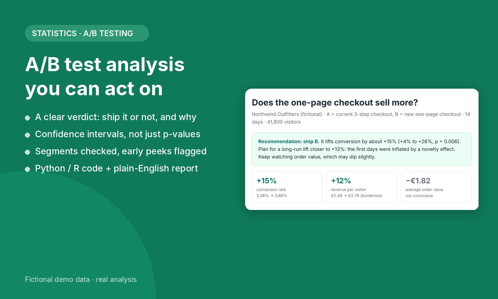

# A/B Test Report: one-page checkout vs three-step checkout

**A worked example of how I analyse an A/B test and turn it into a decision a business owner can act on.**

[**▶ Read the full report**](https://helloyansquared.github.io/ab-test-report/) · Python · pandas · SciPy · statsmodels

> Portfolio demo. "Northwind Outfitters" is a made-up shop and the data is **fictional**, generated by [`make_data.py`](make_data.py).
> The analysis is real and fully reproducible.



## The question

A shop tested a new one-page checkout (B) against its current three-step checkout (A) for 14 days with 41,800 visitors.
Should it ship B, and what lift should it plan for?

## The answer

| | A | B | Result |
|---|---|---|---|
| Conversion rate | 3.38% | 3.89% | **+15%** (95% CI +4% to +26%), p = 0.006 |
| Revenue per visitor | €2.48 | €2.79 | +12%, borderline (p = 0.054) |
| Average order value | €73.53 | €71.71 | not conclusive, worth monitoring |

**Ship B**, and plan for a long-run lift of about **+13%**, not the +46% the test showed on day 2.

## What the analysis checks

1. **Is the test trustworthy?** Sample-ratio mismatch test and the minimum detectable effect (power).
2. **Conversion** with a two-proportion z-test and Newcombe confidence interval.
3. **Money, not just clicks:** revenue per visitor (bootstrap + Welch) and order value (bootstrap + Mann-Whitney).
4. **Segments** (device, new vs returning) with Holm correction, plus a logistic-regression interaction test, so a lucky segment isn't mistaken for a real one.
5. **Peeking and novelty:** the cumulative lift by day shows how stopping early would have overstated the gain.

## Run it

```bash
pip install -r requirements.txt
python make_data.py      # regenerate the fictional dataset
python analysis.py       # statistics + charts -> report/
python make_report.py    # report/report.html
```

## Need this for your own test?

I'm Yanyan, a mathematician (M.Sc. pure mathematics, Sorbonne Université & Shanghai Jiao Tong University) and former product manager at ByteDance.
[Hire me on Fiverr](https://www.fiverr.com/yansquared) · hello@yansquared.com

MIT License
